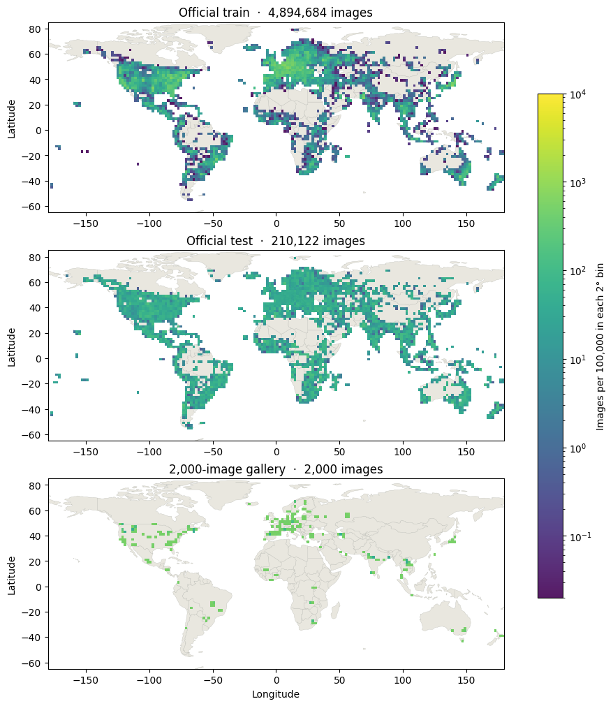
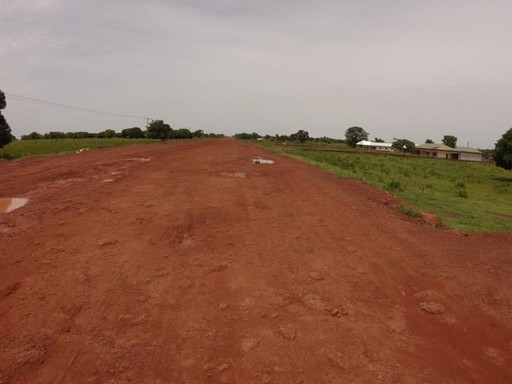
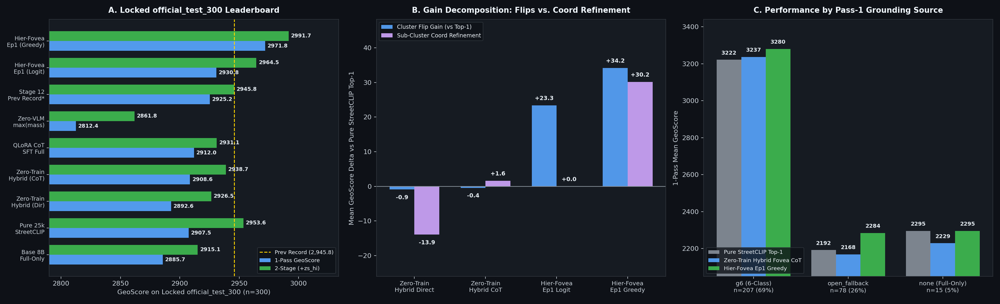

# WhereOnEarth-VL

> **Can a 25,000-image street-view retrieval and vision-language system outperform a 5,000,000-image official geolocalization baseline?**

**WhereOnEarth-VL** is a research report and codebase for **single-image global street-view geolocalization** — predicting country and GPS coordinates from one raw street photo (EXIF-oriented RGB pixels only, with no metadata or sequence context).

We investigate two complementary paradigms — **Vision-Language Models (`Qwen3-VL-2B` QLoRA)** with mechanistic visual/text diagnostics, and **geographic metric retrieval (`geolocal/StreetCLIP` + Geo-Metric Projection + Spatial KDE)** — and evaluate them head-to-head against the 5-million-image official `osv5m/baseline` on a held-out, photographer-disjoint benchmark spanning **147 countries** from the OSV-5M official test set.

---

## Headline Results (`official_test_300` — OSV-5M Official Test)

Evaluated on [`official_test_300`](results/official_test_showdown/README.md) — 300 images from 300 unseen photographers across **147 countries** (OSV-5M official `test`, ≥ 2018-01-01, with all hyperparameters fixed prior to test evaluation):

| Model | Training / Gallery Scale | ≤ 25 km | ≤ 200 km | ≤ 750 km | Country Acc. | Median Error | GeoGuessr Score |
|---|---|---:|---:|---:|---:|---:|---:|
| **`WhereOnEarth-VL v2` (`StreetCLIP` 25k KDE → Hybrid Visual Fovea + `Hier-Fovea` LoRA, 2-Stage)** | **25k gallery + 820 Fovea LoRA** | 2.7% (8) | **25.7% (77)** | **60.0% (180)** | 48.7% (146) | **514.5 km** | **2,991.7** |
| **`WhereOnEarth-VL v2` (`Hier-Fovea` LoRA, Single-Pass Only)** | **25k gallery + 820 Fovea LoRA** | 2.3% (7) | 25.0% (75) | 59.7% (179) | 48.7% (146) | 534.6 km | **2,971.8** |
| `WhereOnEarth-VL v1` (`StreetCLIP` 25k Top-6 KDE → `Qwen3-VL-8B`, 2-Stage) | 25k gallery + 10k proj. + 8B VLM | 3.3% (10) | 25.3% (76) | 58.0% (174) | 48.0% (144) | 556.7 km | 2,945.8 |
| `WhereOnEarth-VL` Zero-Train Hybrid Visual Fovea (CoT, 2-Stage) | 25k gallery + 8B VLM (zero-train) | 3.3% (10) | 25.0% (75) | 58.0% (174) | **49.7% (149)** | 560.5 km | 2,938.7 |
| `StreetCLIP` 25k GeoProj + KDE + Text-Probe (Retrieval Only) | 25k gallery + 10k proj. | 2.7% (8) | 24.3% (73) | 58.0% (174) | 48.0% (144) | 570.3 km | 2,907.5 |
| `StreetCLIP` 25k raw + KDE + Text-Probe | 25k gallery (frozen) | 3.7% (11) | 24.3% (73) | 54.0% (162) | 43.3% (130) | 650.8 km | 2,740.0 |
| `osv5m/baseline` (Official Reference) | **4.89M train images** | **11.0% (33)** | **27.3% (82)** | 49.0% (147) | 41.3% (124) | 804.4 km | 2,590.1 |
| `Qwen3-VL-8B-Instruct` Zero-Shot (No Retrieval) | — | 2.0% (6) | 12.7% (38) | 41.3% (124) | 28.0% (84) | 1,088.4 km | 2,212.8 |
| `Qwen3-VL-2B` 6k QLoRA (Pure VLM) | 6k SFT images | 1.3% (4) | 8.7% (26) | 36.7% (110) | 29.0% (87) | 1,306.7 km | 2,127.4 |
| `Qwen3-VL-2B` Zero-Shot | — | 0.3% (1) | 6.7% (20) | 31.3% (94) | 23.0% (69) | 1,421.9 km | 1,984.9 |
| `dinov2-small` 25k raw Top-1 | 25k gallery (frozen) | 0.3% (1) | 5.7% (17) | 17.3% (52) | 11.0% (33) | 4,603.5 km | 1,186.5 |

- **Head-to-head vs. 5M `osv5m/baseline`:** **`WhereOnEarth-VL v2`** lands closer on **174 of 300 images** (123 losses, 3 ties ≤ 1 km), outperforming the 5M-image official baseline by **+7.4% country accuracy**, **−289.9 km median error**, **+11.0% ≤ 750 km**, and **+401.6 GeoGuessr points** (`2,991.7` vs. `2,590.1`).
- **Statistically Significant Gain Over Retrieval & Full-Image VLM:** Single-pass **`Hier-Fovea` LoRA (`2,971.8`)** beats pure 25k `StreetCLIP` retrieval (`2,907.5`) by **+64.3 points** (10k paired bootstrap **`p = 0.0058`**), full-image Base 8B (`2,885.7`) by **+86.2 points (`p = 0.0166`)**, and identical-crop Zero-Train Hybrid Fovea Direct (`2,892.6`) by **+79.2 points (`p = 0.0256`)** — cutting median error by **35.7 km** single-pass (**55.8 km** two-stage).
- **On the 66-photographer unseen holdout (`author_holdout_66`):** Zero-Training **Hybrid Visual Fovea (CoT)** reaches **69.7% country accuracy (46/66)**, **285.1 km median error**, and **3,612.3 single-pass / 3,627.5 two-stage GeoGuessr points** (+180.9 pts over pure 25k retrieval).
- **On the OSV-5M validation distribution (`qlora_eval_300`, 5-fold OOF):** Fusing 25k `StreetCLIP` Stage 2 Listwise Ranker with `Qwen3-VL-2B` 6k country priors reaches **74.3% country accuracy (223/300)**, **461.2 km median error**, and **3,327.0 GeoGuessr points**.

---

## The Research Story

> For the full experiment ledger, per-stage metrics, and script map, see **[EXPERIMENTS.md](EXPERIMENTS.md)**.

### 1 · Global Distribution Audit & Coverage-First Gallery Design

To understand the geographic structure of OSV-5M before building a retrieval index, we audited all **4.89M training images** and **210k test images** across 222 country codes and `2° × 2°` grid cells. Training data is heavily skewed toward major regions (e.g., 24.9% US, 4.95% France), meaning naive small subsamples leave huge geographic blind spots: a uniform 2,000-image gallery covered only **2/18** pilot queries within 25 km, compared to **18/18** in the full training set.



To make a compact gallery viable, we built a **coverage-first 25,000-image gallery** from post-2018 OSV-5M train (~11 km grid candidates, greedily selected to maximize 25 km spatial coverage). Evaluated on 6,000 held-out post-2018 coverage queries, this 25k gallery reached **97.32%** 25 km coverage — compared to **73.97%** for a random gallery of the same size.

---

### 2 · Fine-Tuning a 2B VLM (`Qwen3-VL-2B`) — Strong Jump, Fast Plateau

We next asked how well a compact vision-language model can geolocate directly from pixels. Using 4-bit NF4 QLoRA (rank 8, LM attention layers, 1 epoch, 512 px max edge), we fine-tuned `Qwen3-VL-2B-Instruct` to output structured JSON `{"country","latitude","longitude"}`:

| Evaluation Set | Model | Valid Coords | Country Acc. | ≤ 25 km | ≤ 200 km | Median Error |
|---|---|---:|---:|---:|---:|---:|
| `qlora_eval_300` (n=300) | Zero-shot | 294 / 300 | 44.0% (132) | 1.3% (4) | 10.7% (32) | 1,141 km |
| `qlora_eval_300` (n=300) | 2k QLoRA | 300 / 300 | 51.3% (154) | 3.0% (9) | 14.7% (44) | 861 km |
| `qlora_eval_300` (n=300) | 6k QLoRA | 300 / 300 | **52.0% (156)** | 2.7% (8) | 14.7% (44) | **832 km** |
| `author_holdout` (66 unseen creators / 60 countries) | Zero-shot | 65 / 66 | 42.4% (28) | 1.5% (1) | 12.1% (8) | 945 km |
| `author_holdout` (66 unseen creators / 60 countries) | 6k QLoRA | 66 / 66 | **50.0% (33)** | 1.5% (1) | **21.2% (14)** | **589 km** (600.3 all) |

Two patterns emerged immediately:
1. **Fine-tuning generalizes to unseen photographers:** On [`author_holdout`](data/author_holdout/README.md) (66 photographers with zero `creator_id` overlap with training), 6k QLoRA landed closer on **42/65** valid photos and cut median error by **356 km**.
2. **Scaling 2k → 6k hit sharp diminishing returns:** Tripling training data yielded only +2 correct countries on 300 eval images. Unweighted token cross-entropy over 3-decimal coordinates carries no spherical distance geometry (a hemisphere sign flip costs 1 token, the same as a 0.001° perturbation).

---

### 3 · Diagnosing the Bottleneck: Vision vs. Reasoning

Before unfreezing the vision encoder, we ran three targeted diagnostics to pinpoint why the 2B VLM plateaued:

1. **Road Center-Line Probes & Crop Study ([`roadmark_probe`](results/roadmark_probe/README.md), [`roadmark_crop_probe`](results/roadmark_crop_probe/README.md)):**
   Using our local blind [annotation tool](annotation_tool/README.md), we labeled 70 street scenes for single vs. double road center lines. On 11 same-country pairs (22 images), simply **cropping around the road center line** with **all weights frozen** produced major gains:
   - Frozen Projector + DeepStack linear probe: **54.5% → 81.8%** (12 → 18/22)
   - Base `Qwen3-VL` QA: **63.6% → 81.8%** (14 → 18/22)
   - 6k LoRA QA: **72.7% → 86.4%** (16 → 19/22), ranking **11/11** same-country pairs correctly.
   - **Finding:** The frozen ViT already encodes fine road details once resolution and framing are sufficient; unfreezing the ViT is not the primary lever.

2. **Scene Text & LM Attention Interventions ([`text_attention`](results/text_attention/README.md)):**
   On three diagnostic cases (a Canadian dashcam showing `W111.421436 N50.36211`, a Guadeloupe French trail sign `POINTE DES CHATEAUX`, and a Brazilian storefront), **the 6k fine-tuned model already transcribed the text accurately from the full uncropped image**. Yet even when **human-verified transcripts** were injected directly into the prompt:
   - On Canada, the 6k model copied latitude accurately but output `+111.421` instead of `-111.421` (8,102 km error, country `TM`).
   - On Guadeloupe, both base and fine-tuned models still guessed metropolitan Europe (6,909 km error).
   - **Finding:** The bottleneck for a 2B VLM is coordinate-sign consistency and world-scale toponym knowledge — pointing toward external geocoding/gazetteer lookup rather than more ViT training.

3. **Clue-First Prompting & Multi-Task Clue Extraction ([`clue_first`](results/clue_first/README.md), [`clue_first_training`](results/clue_first_training/README.md)):**
   Zero-shot two-stage prompting ("read signage first, then geolocate") **degraded** localization (`33 → 30/66` countries) because the model hallucinated place names on signless roads (e.g., inventing `Saray` on an Ethiopian mountain track).

   To test whether explicit supervision helps, we curated 104 manually verified photos (258 multi-task questions across verbatim sign OCR, empty-text abstention, structured road attributes, and clue-conditioned localization) and continued LM LoRA training for 69 steps:

   | Example Training Inputs (OSV-5M, CC BY-SA 4.0) | |
   |---|---|
   | <br>*Sign transcription:* `{"text":["MERCADO DE PEIXE"]}` | <br>*Multi-task:* empty text `[]`, road JSON `{"surface":"unpaved","centerline":"none","roadside":[]}`, and GPS |

   - **Clue extraction improved sharply:** roadside-object exact match rose **7/29 → 27/29** (micro-F1 0.938), empty-text abstention reached **21/21** (up from 11/21), and valid JSON hit **66/66**.
   - **Direct localization regressed:** country accuracy fell **33 → 30/66** (≤ 200 km `14 → 10/66`) due to task dilution and overly conservative OCR abstention (59/66 blank).
   - **Finding:** Keep clue extraction and geolocalization as separate specialized modules rather than sharing a single 2B adapter.

---

### 4 · Geographic Metric Retrieval, `StreetCLIP` & The 25k vs. 5M Showdown

Because a 2B VLM hits a parameter-memory ceiling on global street appearance, we turned to **geographic retrieval with learned metric re-ranking** ([`retrieval_v2`](results/retrieval_v2/README.md), [`official_test_showdown`](results/official_test_showdown/README.md)).

Starting from a strict photographer-disjoint `dinov2-small` 25k baseline (`21.4%` country accuracy, `3,965 km` median error on `val_2000`), we built the retrieval stack step by step:

1. **Spatial KDE Voting:** Replacing greedy Top-1 selection with kernel density voting over Top-50 neighbors cut `dinov2-small` median error from `3,965 → 2,737 km`.
2. **Two-Stage Geo-Metric Projection & Listwise Ranking:**
   - **Stage 1 (`GeoProjector`):** A shared residual projection + auxiliary country head trained across all 25,000 gallery items using multi-scale geographic soft targets (35 / 180 / 600 km + same-country). Crucially, during training we treat distant images from the same photographer (> 300 km apart) as explicit **hard negatives**, teaching the projection to ignore camera mounts, windshield tint, and dashcam watermarks.
   - **Stage 2 (`ListwiseGeoRanker`):** A bounded residual ranker trained with Listwise Softmax KL over scale-normalized Top-100 features (projected/raw cosine, multi-scale KDE, gallery-density debiasing, Top-100 country consensus, zero-shot country text probes, and auxiliary country priors).
   - Together, Stages 1–2 lifted `dinov2-small` on `val_2000` from **21.4% → 49.9%** country accuracy and **3,965 → 1,032 km** median error.
3. **Upgrading to `geolocal/StreetCLIP` (ViT-L/14) & Scaling to 25k:**
   - On a 6,000-image proof-of-concept gallery, swapping `dinov2-small` for geo-pretrained `StreetCLIP` (plus bottom-12% HUD cropping, Spatial KDE, zero-shot country text probes, and exact 211-country `Qwen3-VL` log-prob priors) pushed `author_holdout_66` to **69.7% country accuracy**, **389.7 km median error**, and **3,395.4 GeoGuessr points**.
   - Scaling `StreetCLIP` to all **39,300 images** (25k gallery + 12k train + 2k val + 300 official test, encoded in 18.4 minutes on Colab L4) and training the 25k GeoProjector & Listwise Ranker gave a strong pure-retrieval backbone: **`48.0%`** country accuracy / **`2,907.5`** GeoGuessr points on `official_test_300` (**166–131** over 5M `osv5m/baseline`), **`71.9%`** on `val_2000`, and **`74.3%`** on `qlora_eval_300` (+ VLM priors).

---

### 5 · Closing the Loop: Passing the Spatial KDE Distribution to `Qwen3-VL-8B-Instruct`

Pure retrieval is limited to copying coordinates from one of 25,000 discrete gallery points, and `StreetCLIP`'s 336 px vision encoder misses fine signage, postal codes, and license plates. Rather than blending an independent 2B VLM with a fixed weight, we pass the **25k spatial KDE posterior distribution** (Top-6 distinct countries with KDE weights, neighbor counts, peak coordinates, secondary regional clusters, and text-probe ranks — `92.4%` Top-6 country recall on `author_holdout_66` and `73.7%` on `official_test_300`) directly to **`Qwen3-VL-8B-Instruct`** (4-bit NF4) to contrast competing candidates and refine coordinates ([`results/vlm_kde_rerank/README.md`](results/vlm_kde_rerank/README.md)).

Development on `author_holdout_66` revealed an important VLM calibration effect: showing the KDE list in a single pass caused anchoring bias (conservative prompts suppressed clear signs like `BOUAKÉ`; aggressive prompts inflated `high` confidence from 4 → 32/66). Combining an **unbiased standalone visual read** (`confidence == "high"` fires selectively on unmistakable signs/scripts) with **confidence-gated KDE reranking** resolved the bias and lifted every metric simultaneously:

- **`author_holdout_66`:** `63.6% → 68.2%` country accuracy, `356.2 → 313.6 km` median error, `3,446.6 → 3,494.9` GeoScore (+48.3 pts over retrieval, +1,057.6 pts over standalone 8B zero-shot).
- **`official_test_300` (locked, zero tuning on test):** `2,907.5 → 2,945.8` GeoScore (+38.3 pts over retrieval, **+355.7 pts** and **170–126** head-to-head over 5M `osv5m/baseline`), median error `570.2 → 556.7 km`, ≤ 25 km hits `8 → 10` (`13` with narrow local KDE), and ≤ 200 km hits `73 → 76`.
- **Concrete VLM rescues on `official_test_300`:** reading Korean signage (`"Pizza maru"`) flipped Taiwan (`1,544 km`) → South Korea (**`10.0 km`**); reading `"Oeuvres Universitaires de Dakar"` flipped Burkina Faso (`1,286 km`) → Senegal (**`174.8 km`**); reading `"CORREOS DE CUBA C.P. 27200"` refined Cuba from `651.9 → 71.4 km`; reading `"Algeciras A-7"` refined Spain from `457.8 → 43.0 km`.

#### Three Key Technical Takeaways

1. **Global Score vs. Pinpoint (≤ 25 km) Tradeoff:** `WhereOnEarth-VL v2` beats 5M `osv5m/baseline` globally (+401.6 GeoGuessr pts, −289.9 km median, 174–123 wins), while `osv5m/baseline` maintains a lead at ≤ 25 km (`11.0%` vs. `2.7–4.3%`) due to 200× higher training density. Scaling the gallery (25k → 100k+) and pairing coarse-to-fine KDE with high-resolution sign crops is the clearest path to closing the ≤ 25 km gap.
2. **Prior-Free Stage 1 Generalizes Best Across Distribution Shift:** Stage 2 `ListwiseGeoRanker` leverages OSV-5M country-frequency features and dominates on OSV-5M's US/RU/EU-heavy `val_2000` (71.9%) and `qlora_eval_300` (74.3%). On uniformly stratified 147-country `official_test_300`, prior-free **Stage 1 GeoProj + KDE + Text-Probe** generalizes strongest and provides the cleanest candidate distribution for the VLM.
3. **Selective VLM Reasoning Beats Fixed-Weight Blending:** Fixed-weight fusion with `Qwen3-VL-2B` hurt on 147-country `official_test_300` (`2,907.5 → 2,814.3`), whereas **confidence-gated two-stage `Qwen3-VL-8B` reasoning over the KDE distribution** added **+38.3 pts** in v1 (`2,945.8`) and **+84.2 pts** with Hybrid Visual Fovea + Hierarchical Geographic Loss in v2 (`2,991.7`).

---

### 6 · Visual Fovea, Mechanistic Attention Diagnostics & Hierarchical Geographic Loss

Holding the **25k `StreetCLIP` + `Qwen3-VL-8B-Instruct`** backbone fixed, we investigated why standard CoT SFT (`2,931.1`) and Offline DPO (`3,456.7` on holdout) failed to break past the Stage 12 ceiling ([`results/vlm_test300_fovea_showdown/README.md`](results/vlm_test300_fovea_showdown/README.md)):

1. **7.9× Cross-Attention Collapse & Sky Sink:** Extracting layer-averaged LM visual cross-attention revealed that once the Top-8 KDE table enters context, total visual attention collapses **7.9×** (`6.87% → 0.87%`) with `23.5%` trapped on top-left corner pixel `[0,0]` and `< 0.6×` concentration inside detected poles, bollards, and signs. Both `Image-Last` prompting (`-19.6` pts) and frozen ViT Patch-MIL cropping (hijacked by sky register tokens) failed to fix this collapse.
2. **Hybrid Self-Zoom Visual Fovea (Zero Training):** Asking `Qwen3-VL-8B` in Pass 1 to natively localize 6 high-precision infrastructure classes (`text sign`, `road sign`, `license plate`, `utility pole`, `bollard`, `road marking`) — falling back to zero-sky Open-Ended grounding when none are detected (`95.0%` coverage on `official_test_300`) — and placing up to 2 high-res crops **before** the KDE table immediately lifted `author_holdout_66` to **`3,612.3` 1-pass / `3,627.5` 2-stage (`69.7%` country acc.)**.
3. **Unfrozen Merger Forensics vs. Frozen-Vision Hierarchical Geographic Loss (`Hier-Fovea` LoRA):**
   - Unfreezing `160.5M` visual merger parameters (`lr=6e-5`) on isolated cue MCQs caused catastrophic OCR forgetting (`64.7% → 29.4%`), exposed a distractor-prior confounder, and amplified the `[0,0]` Attention Sink **2.57×** (`23.5% → 60.3%`).
   - Instead, **freezing Vision + Mergers (`0%` forgetting on isolated MCQ: `48.82%`, non-text `+2.15%`)** and training lightweight LM LoRA (`43.65M`) on 820 creator-disjoint Visual Fovea scenes with a **4-scale differentiable Hierarchical Geographic Loss** (`2500 km` macro KL + `750 km` country KL + `200 km` fine KL + direct `Expected GeoScore Regret` + true GPS coordinate SFT) achieved a decisive breakthrough on locked **`official_test_300`**:
     - **`2,971.8` single-pass** (`+64.3` over pure retrieval, **`p = 0.0058`**; `+86.2` over Base Full-Only, **`p = 0.0166`**; `+79.2` over identical-crop Zero-Train Direct, **`p = 0.0256`**) and **`2,991.7` two-stage** (`514.5 km` median error, **174–123** over 5M `osv5m/baseline`).
     - Exact gain decomposition vs. retrieval: **`+34.2` pts** from disciplined cluster flipping (`31/300` flips at `58.1%` win rate vs. zero-training's `61–73` flips at `42.5%`) + **`+30.2` pts** from sub-cluster coordinate refinement (moving off cluster centroids to true cities/islands such as Canary Islands `+3,117` and Jakarta `+2,127`).



---

## Data Splits & Evaluation Protocol

All models receive identical EXIF-oriented RGB pixels; GPS coordinates, country codes, and EXIF metadata are withheld until scoring. For retrieval, gallery matches sharing the query photographer (`attribution`) are always excluded, and all fusion weights are tuned via 5-fold cross-validation on `qlora_eval_300` before being evaluated unmodified on `author_holdout` and `official_test_300`.

| Split | Size | Source | Partitioning | Role |
|---|---:|---|---|---|
| `pilot_dev` / `pilot_holdout` | 18 / 18 | OSV-5M `test` (FR) + Panoramax IGN | Disjoint capture sequences; ≥ 10.43 km split gap | Initial cross-platform pipeline check |
| `since_2018` ranker splits | 25k gallery / 12k train / 2k val / 6k cov | OSV-5M official `train` (≥ 2018) | Disjoint image IDs & sequences; photographer-disjoint train/tune/retrieval | Retrieval & Geo-Ranker training / validation |
| `qlora_since_2018` | 2k & 6k train / 300 eval | Subsets of `since_2018` train & val | Disjoint IDs, sequences, and SHA-256 | QLoRA SFT & 5-fold OOF fusion tuning |
| `author_holdout` | 66 (66 creators, 60 countries) | `since_2018` val (66/72 visually audited) | Disjoint `creator_id` from 6k train & 300 eval | Unseen-photographer diagnostic holdout |
| **`official_test_300`** | **300 (300 creators, 147 countries)** | **OSV-5M official `test` (≥ 2018, OCR-checked)** | **Disjoint photographers & images from all train/val/gallery & `osv5m/baseline` train** | **Primary final test benchmark** |
| `roadmark_annotations` | 70 (43 binary, 43 creators) | 6k QLoRA train subset (blind-labeled) | Disjoint creators across 5 folds | Center-line ViT/crop probe only |

---

## Repository Structure

```text
WhereOnEarth-VL/
├── README.md                            # Project overview & research story (this file)
├── EXPERIMENTS.md                       # Full 16-stage experiment index, metrics & bottlenecks
├── requirements-colab.txt               # Pinned Colab dependencies
├── notebooks/                           # 7 Colab notebooks (GPU check through QLoRA SFT)
│   ├── 00_colab_gpu.ipynb
│   ├── 01_phase1_colab.ipynb
│   ├── 02_frozen_retrieval.ipynb
│   ├── 03_dataset_distribution.ipynb
│   ├── 04_ranker_preprocessing.ipynb
│   ├── 05_ranker_colab.ipynb
│   └── 06_sft_colab.ipynb
├── scripts/                             # End-to-end data prep, training, probe & eval scripts
├── results/                             # Metrics, figures & per-stage technical reports
│   ├── distribution_audit/              # OSV-5M 4.89M global distribution tables & plots
│   ├── roadmark_probe/README.md         # Frozen ViT / Projector / DeepStack center-line probe
│   ├── roadmark_crop_probe/README.md    # Full-image vs. fixed crop vs. manual crop study
│   ├── text_attention/README.md         # Scene-text OCR & LM attention heatmaps
│   ├── clue_first/README.md             # Two-stage clue-first prompting diagnosis
│   ├── clue_first_training/README.md    # Multi-task clue-extraction LM LoRA training report
│   ├── retrieval_v2/README.md           # Creator-disjoint retrieval v2 & StreetCLIP 6k PoC
│   ├── official_test_showdown/README.md # 25k StreetCLIP vs. 5M osv5m/baseline showdown
│   ├── vlm_kde_rerank/README.md         # Spatial KDE → Qwen3-VL-8B rerank & coordinate refinement
│   └── vlm_test300_fovea_showdown/README.md # Stages 13–16: Visual Fovea, attention diagnostics & Hier-Fovea LoRA
├── data/                                # Small docs, audit records & manual labels (media ignored)
│   ├── author_holdout/README.md         # 66-creator holdout report & visual review log
│   ├── official_test_300/hud_audit.json
│   └── roadmark_annotations/labels.json
├── webapp/                              # Offline Leaflet map comparator for 300-image VLM eval
└── annotation_tool/                     # Local blind road center-line annotation web app
```

---

## Reproducibility & Local Tools

> **Large artifacts:** Raw street-view images, OSV-5M CSVs, Colab upload ZIPs, cached `.npz` embeddings, and LoRA weight archives are excluded via [`.gitignore`](.gitignore). Every split, manifest, and metric table can be regenerated deterministically from pinned OSV-5M and Hugging Face revisions.

- **Key script pipelines:**
  - *Pilot & distribution audit:* `scripts/prepare_pilot.py`, `scripts/build_bundles.py`, `scripts/phase1.py`, `scripts/audit_distribution.py`
  - *Coverage-first 25k gallery & retrieval:* `scripts/cache_train_metadata.py`, `scripts/select_ranker_data.py`, `scripts/materialize_ranker_data.py`, `scripts/train_ranker.py`
  - *Qwen3-VL QLoRA & unseen-creator eval:* `scripts/prepare_sft_data.py`, `scripts/sft_colab.py`, `scripts/prepare_author_holdout.py`, `scripts/evaluate_author_holdout.py`
  - *Visual/text probes & clue-first SFT:* `scripts/extract_roadmark_features.py`, `scripts/analyze_roadmark_probe.py`, `scripts/probe_text_attention.py`, `scripts/render_text_attention.py`, `scripts/train_clue_first.py`, `scripts/analyze_clue_training.py`
  - *Retrieval v2 & 25k StreetCLIP official showdown:* `scripts/eval_spatial_kde.py`, `scripts/train_geo_ranker.py`, `scripts/extract_vlm_country_priors.py`, `scripts/prepare_official_test.py`, `scripts/encode_and_train_streetclip_25k.py`, `scripts/evaluate_official_test_models.py`, `scripts/evaluate_official_test_showdown.py`
  - *Spatial KDE → `Qwen3-VL-8B-Instruct` reranking & refinement:* `scripts/kde_vlm_utils.py`, `scripts/run_qwen8b_kde_rerank.py`, `scripts/prepare_vlm_rerank_bundle.py`, `scripts/evaluate_vlm_rerank.py`
  - *Visual Fovea, Attention Diagnostics & Hierarchical Geographic Loss:* `scripts/multiscale_vlm_utils.py`, `scripts/run_step0_grounding_attention.py`, `scripts/run_step1_mil_and_sink.py`, `scripts/run_dir2_harvest_crops.py`, `scripts/train_dir2_unfrozen_merger.py`, `scripts/prepare_hier_fovea_bundle.py`, `scripts/train_hier_fovea_lora.py`, `scripts/prepare_test300_fovea_bundle.py`, `scripts/run_locked_test300_fovea_showdown.py`
- **Interactive Prediction Viewer:** See [`webapp/README.md`](webapp/README.md) to rebuild data from local evaluation archives and inspect Zero-shot vs. 2k vs. 6k QLoRA guesses side-by-side on synchronized Leaflet maps.
- **Blind Road-Marking Annotator:** See [`annotation_tool/README.md`](annotation_tool/README.md) to run the local keyboard-driven annotator at `http://127.0.0.1:8766/`.

## References

- [OSV-5M: OpenStreetView-5M Dataset & Baseline (CVPR 2024)](https://arxiv.org/abs/2404.18873) · [Pinned HF Snapshot](https://huggingface.co/datasets/osv5m/osv5m/tree/cff33609b56b54d8743b7ee7a416eb8433e9a681)
- [StreetCLIP (`geolocal/StreetCLIP`)](https://huggingface.co/geolocal/StreetCLIP)
- [Qwen3-VL-2B-Instruct](https://huggingface.co/Qwen/Qwen3-VL-2B-Instruct)
- [Panoramax STAC API](https://docs.panoramax.fr/backend/api/api/)
- [Plonk It GeoGuessr Guide](https://www.plonkit.net/beginners-guide)
