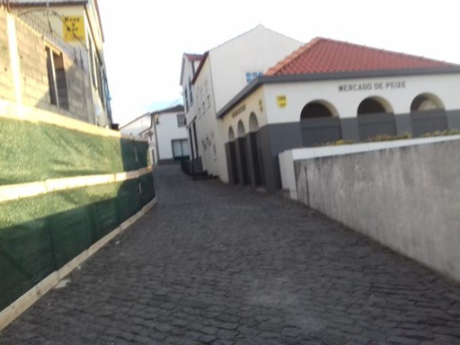

# WhereOnEarth-VL

> **Can a 25,000-image street-view retrieval and vision-language system outperform a 5,000,000-image official geolocalization baseline?**

**WhereOnEarth-VL** is a research report and codebase for **single-image global street-view geolocalization** — predicting country and GPS coordinates from one raw street photo (EXIF-oriented RGB pixels only, with no metadata or sequence context).

We investigate two complementary paradigms — **Vision-Language Models (`Qwen3-VL-2B` QLoRA)** with mechanistic visual/text diagnostics, and **geographic metric retrieval (`geolocal/StreetCLIP` + Geo-Metric Projection + Spatial KDE)** — and evaluate them head-to-head against the 5-million-image official `osv5m/baseline` on a held-out, photographer-disjoint benchmark spanning **147 countries** from the OSV-5M official test set.

---

## Headline Results (`official_test_300` — OSV-5M Official Test)

Evaluated on [`official_test_300`](results/official_test_showdown/README.md) — 300 images from 300 unseen photographers across **147 countries** (OSV-5M official `test`, ≥ 2018-01-01, with all hyperparameters fixed prior to test evaluation):

| Model | Training / Gallery Scale | ≤ 25 km | ≤ 200 km | ≤ 750 km | Country Acc. | Median Error | GeoGuessr Score |
|---|---|---:|---:|---:|---:|---:|---:|
| **`StreetCLIP` 25k GeoProj + KDE + Text-Probe (Ours)** | **25k gallery + 10k proj.** | 2.7% (8) | 24.3% (73) | **58.0% (174)** | **48.0% (144)** | **570.2 km** | **2,907.5** |
| `osv5m/baseline` (Official Reference) | **4.89M train images** | **11.0% (33)** | **27.3% (82)** | 49.0% (147) | 41.3% (124) | 804.4 km | 2,590.1 |
| `StreetCLIP` 25k raw + KDE + Text-Probe | 25k gallery (frozen) | 3.7% (11) | 24.3% (73) | 54.0% (162) | 43.3% (130) | 650.8 km | 2,740.0 |
| `StreetCLIP` 25k GeoProj + KDE + Text + Qwen3-VL 6k | 25k + 6k QLoRA | 1.3% (4) | 21.3% (64) | 55.7% (167) | 43.7% (131) | 630.0 km | 2,814.3 |
| `Qwen3-VL-2B` 6k QLoRA (Pure VLM) | 6k SFT images | 1.3% (4) | 8.7% (26) | 36.7% (110) | 29.0% (87) | 1,306.7 km | 2,127.4 |
| `Qwen3-VL-2B` Zero-Shot | — | 0.3% (1) | 6.7% (20) | 31.3% (94) | 23.0% (69) | 1,421.9 km | 1,984.9 |
| `dinov2-small` 25k raw Top-1 | 25k gallery (frozen) | 0.3% (1) | 5.7% (17) | 17.3% (52) | 11.0% (33) | 4,603.5 km | 1,186.5 |

- **Head-to-head vs. 5M `osv5m/baseline`:** Our 25k `StreetCLIP` GeoProj + KDE + Text-Probe model lands closer on **166 of 300 images** (131 losses, 3 ties ≤ 1 km), outperforming the 5M-image official baseline by **+6.7% country accuracy**, **−234.2 km median error**, and **+317.4 GeoGuessr points**.
- **On the OSV-5M validation distribution (`qlora_eval_300`, 5-fold OOF):** Fusing 25k `StreetCLIP` Stage 2 Listwise Ranker with `Qwen3-VL-2B` 6k country priors reaches **74.3% country accuracy (223/300)**, **461.2 km median error**, and **3,327.0 GeoGuessr points**.
- **On the 66-photographer unseen holdout (`author_holdout_66`):** 25k `StreetCLIP` Stage 1 GeoProj + KDE achieves **318.2 km median error**, **33.3% ≤ 200 km**, and **3,465.3 GeoGuessr points** (up from 2,788.6 for pure VLM).

---

## The Research Story

> For the full experiment ledger, per-stage metrics, and script map, see **[EXPERIMENTS.md](EXPERIMENTS.md)**.

### 1 · Global Distribution Audit & Coverage-First Gallery Design

To understand the geographic structure of OSV-5M before building a retrieval index, we audited all **4.89M training images** and **210k test images** across 222 country codes and `2° × 2°` grid cells. Training data is heavily skewed toward major regions (e.g., 24.9% US, 4.95% France), meaning naive small subsamples leave huge geographic blind spots: a uniform 2,000-image gallery covered only **2/18** pilot queries within 25 km, compared to **18/18** in the full training set.


To make a compact gallery viable, we built a **coverage-first 25,000-image gallery** from post-2018 OSV-5M train (~11 km grid candidates, greedily selected to maximize 25 km spatial coverage). Evaluated on 6,000 held-out post-2018 coverage queries, this 25k gallery reached **97.32%** 25 km coverage — compared to **73.97%** for a random gallery of the same size.

---

### 2 · Fine-Tuning a 2B VLM (`Qwen3-VL-2B`) — Strong Jump, Fast Plateau

We next asked how well a compact vision-language model can geolocate directly from pixels. Using 4-bit NF4 QLoRA (rank 8, LM attention layers, 1 epoch, 512 px max edge), we fine-tuned `Qwen3-VL-2B-Instruct` to output structured JSON `{"country","latitude","longitude"}`:

| Evaluation Set | Model | Valid Coords | Country Acc. | ≤ 25 km | ≤ 200 km | Median Error |
|---|---|---:|---:|---:|---:|---:|
| `qlora_eval_300` (n=300) | Zero-shot | 294 / 300 | 44.0% (132) | 1.3% (4) | 10.7% (32) | 1,141 km |
| `qlora_eval_300` (n=300) | 2k QLoRA | 300 / 300 | 51.3% (154) | 3.0% (9) | 14.7% (44) | 861 km |
| `qlora_eval_300` (n=300) | 6k QLoRA | 300 / 300 | **52.0% (156)** | 2.7% (8) | 14.7% (44) | **832 km** |
| `author_holdout` (66 unseen creators / 60 countries) | Zero-shot | 65 / 66 | 42.4% (28) | 1.5% (1) | 12.1% (8) | 945 km |
| `author_holdout` (66 unseen creators / 60 countries) | 6k QLoRA | 66 / 66 | **50.0% (33)** | 1.5% (1) | **21.2% (14)** | **589 km** (600.3 all) |

Two patterns emerged immediately:
1. **Fine-tuning generalizes to unseen photographers:** On [`author_holdout`](data/author_holdout/README.md) (66 photographers with zero `creator_id` overlap with training), 6k QLoRA landed closer on **42/65** valid photos and cut median error by **356 km**.
2. **Scaling 2k → 6k hit sharp diminishing returns:** Tripling training data yielded only +2 correct countries on 300 eval images. Unweighted token cross-entropy over 3-decimal coordinates carries no spherical distance geometry (a hemisphere sign flip costs 1 token, the same as a 0.001° perturbation).

---

### 3 · Diagnosing the Bottleneck: Vision vs. Reasoning

Before unfreezing the vision encoder, we ran three targeted diagnostics to pinpoint why the 2B VLM plateaued:

1. **Road Center-Line Probes & Crop Study ([`roadmark_probe`](results/roadmark_probe/README.md), [`roadmark_crop_probe`](results/roadmark_crop_probe/README.md)):**
   Using our local blind [annotation tool](annotation_tool/README.md), we labeled 70 street scenes for single vs. double road center lines. On 11 same-country pairs (22 images), simply **cropping around the road center line** with **all weights frozen** produced major gains:
   - Frozen Projector + DeepStack linear probe: **54.5% → 81.8%** (12 → 18/22)
   - Base `Qwen3-VL` QA: **63.6% → 81.8%** (14 → 18/22)
   - 6k LoRA QA: **72.7% → 86.4%** (16 → 19/22), ranking **11/11** same-country pairs correctly.
   - **Finding:** The frozen ViT already encodes fine road details once resolution and framing are sufficient; unfreezing the ViT is not the primary lever.

2. **Scene Text & LM Attention Interventions ([`text_attention`](results/text_attention/README.md)):**
   On three diagnostic cases (a Canadian dashcam showing `W111.421436 N50.36211`, a Guadeloupe French trail sign `POINTE DES CHATEAUX`, and a Brazilian storefront), **the 6k fine-tuned model already transcribed the text accurately from the full uncropped image**. Yet even when **human-verified transcripts** were injected directly into the prompt:
   - On Canada, the 6k model copied latitude accurately but output `+111.421` instead of `-111.421` (8,102 km error, country `TM`).
   - On Guadeloupe, both base and fine-tuned models still guessed metropolitan Europe (6,909 km error).
   - **Finding:** The bottleneck for a 2B VLM is coordinate-sign consistency and world-scale toponym knowledge — pointing toward external geocoding/gazetteer lookup rather than more ViT training.

3. **Clue-First Prompting & Multi-Task Clue Extraction ([`clue_first`](results/clue_first/README.md), [`clue_first_training`](results/clue_first_training/README.md)):**
   Zero-shot two-stage prompting ("read signage first, then geolocate") **degraded** localization (`33 → 30/66` countries) because the model hallucinated place names on signless roads (e.g., inventing `Saray` on an Ethiopian mountain track).

   To test whether explicit supervision helps, we curated 104 manually verified photos (258 multi-task questions across verbatim sign OCR, empty-text abstention, structured road attributes, and clue-conditioned localization) and continued LM LoRA training for 69 steps:

   | Example Training Inputs (OSV-5M, CC BY-SA 4.0) | |
   |---|---|
   | <br>*Sign transcription:* `{"text":["MERCADO DE PEIXE"]}` | <br>*Multi-task:* empty text `[]`, road JSON `{"surface":"unpaved","centerline":"none","roadside":[]}`, and GPS |

   - **Clue extraction improved sharply:** roadside-object exact match rose **7/29 → 27/29** (micro-F1 0.938), empty-text abstention reached **21/21** (up from 11/21), and valid JSON hit **66/66**.
   - **Direct localization regressed:** country accuracy fell **33 → 30/66** (≤ 200 km `14 → 10/66`) due to task dilution and overly conservative OCR abstention (59/66 blank).
   - **Finding:** Keep clue extraction and geolocalization as separate specialized modules rather than sharing a single 2B adapter.

---

### 4 · Geographic Metric Retrieval, `StreetCLIP` & The 25k vs. 5M Showdown

Because a 2B VLM hits a parameter-memory ceiling on global street appearance, we turned to **geographic retrieval with learned metric re-ranking** ([`retrieval_v2`](results/retrieval_v2/README.md), [`official_test_showdown`](results/official_test_showdown/README.md)).

Starting from a strict photographer-disjoint `dinov2-small` 25k baseline (`21.4%` country accuracy, `3,965 km` median error on `val_2000`), we built the retrieval stack step by step:

1. **Spatial KDE Voting:** Replacing greedy Top-1 selection with kernel density voting over Top-50 neighbors cut `dinov2-small` median error from `3,965 → 2,737 km`.
2. **Two-Stage Geo-Metric Projection & Listwise Ranking:**
   - **Stage 1 (`GeoProjector`):** A shared residual projection + auxiliary country head trained across all 25,000 gallery items using multi-scale geographic soft targets (35 / 180 / 600 km + same-country). Crucially, during training we treat distant images from the same photographer (> 300 km apart) as explicit **hard negatives**, teaching the projection to ignore camera mounts, windshield tint, and dashcam watermarks.
   - **Stage 2 (`ListwiseGeoRanker`):** A bounded residual ranker trained with Listwise Softmax KL over scale-normalized Top-100 features (projected/raw cosine, multi-scale KDE, gallery-density debiasing, Top-100 country consensus, zero-shot country text probes, and auxiliary country priors).
   - Together, Stages 1–2 lifted `dinov2-small` on `val_2000` from **21.4% → 49.9%** country accuracy and **3,965 → 1,032 km** median error.
3. **Upgrading to `geolocal/StreetCLIP` (ViT-L/14) & Scaling to 25k:**
   - On a 6,000-image proof-of-concept gallery, swapping `dinov2-small` for geo-pretrained `StreetCLIP` (plus bottom-12% HUD cropping, Spatial KDE, zero-shot country text probes, and exact 211-country `Qwen3-VL` log-prob priors) pushed `author_holdout_66` to **69.7% country accuracy**, **389.7 km median error**, and **3,395.4 GeoGuessr points**.
   - Scaling `StreetCLIP` to all **39,300 images** (25k gallery + 12k train + 2k val + 300 official test, encoded in 18.4 minutes on Colab L4) and training the 25k GeoProjector & Listwise Ranker delivered our best results across every split:
     - **`official_test_300` (147 countries):** **`48.0%`** country accuracy, **`570.2 km`** median error, **`2,907.5`** GeoGuessr points (**166–131** head-to-head over 5M `osv5m/baseline`).
     - **`val_2000`:** **`71.9%`** country accuracy, **`474.9 km`** median error, **`3,232.0`** points.
     - **`qlora_eval_300` (+ VLM priors, 5-fold OOF):** **`74.3%`** country accuracy, **`461.2 km`** median error, **`3,327.0`** points.
     - **`author_holdout_66`:** **`318.2 km`** median error, **`33.3%`** ≤ 200 km, **`3,465.3`** points.

#### Three Key Technical Takeaways

1. **Global Score vs. Pinpoint (≤ 25 km) Tradeoff:** Our 25k system beats 5M `osv5m/baseline` globally (+317 GeoGuessr pts, −234 km median), while `osv5m/baseline` maintains a lead at ≤ 25 km (`11.0%` vs. `2.7–3.7%`). Two factors explain this: `osv5m/baseline` has 200× more training density, and our wide-kernel KDE (`σ = 500 km`) deliberately favors regional safety over sharp single-point bets (without KDE, Stage 1 Top-1 gets 11 hits ≤ 25 km vs. 8 with KDE, but median error worsens `570 → 682 km`). **Next lever:** coarse-to-fine KDE (`σ = 500 km` region → `σ = 30–50 km` local refinement) + scaling the gallery to 100k+.
2. **Prior-Free Stage 1 Generalizes Best Across Distribution Shift:** Stage 2 `ListwiseGeoRanker` leverages OSV-5M country-frequency features and dominates on OSV-5M's US/RU/EU-heavy `val_2000` (71.9%) and `qlora_eval_300` (74.3%). On uniformly stratified 147-country `official_test_300`, prior-free **Stage 1 GeoProj + KDE + Text-Probe** generalizes strongest (**48.0%** vs. 44.0%).
3. **Gate VLM Fusion by Confidence / OCR Rather Than Fixed Weights:** Fusing `Qwen3-VL` 6k priors at fixed weight `0.3` boosted major-country `qlora_eval_300` (`52%` VLM accuracy → `74.3%` hybrid), but dragged down 147-country `official_test_300` where VLM accuracy falls to `29.0%` (`48.0% → 43.7%`). Future VLM fusion should trigger selectively when high-confidence readable signage is detected and verified against an offline GeoNames gazetteer.

---

## Data Splits & Evaluation Protocol

All models receive identical EXIF-oriented RGB pixels; GPS coordinates, country codes, and EXIF metadata are withheld until scoring. For retrieval, gallery matches sharing the query photographer (`attribution`) are always excluded, and all fusion weights are tuned via 5-fold cross-validation on `qlora_eval_300` before being evaluated unmodified on `author_holdout` and `official_test_300`.

| Split | Size | Source | Partitioning | Role |
|---|---:|---|---|---|
| `pilot_dev` / `pilot_holdout` | 18 / 18 | OSV-5M `test` (FR) + Panoramax IGN | Disjoint capture sequences; ≥ 10.43 km split gap | Initial cross-platform pipeline check |
| `since_2018` ranker splits | 25k gallery / 12k train / 2k val / 6k cov | OSV-5M official `train` (≥ 2018) | Disjoint image IDs & sequences; photographer-disjoint train/tune/retrieval | Retrieval & Geo-Ranker training / validation |
| `qlora_since_2018` | 2k & 6k train / 300 eval | Subsets of `since_2018` train & val | Disjoint IDs, sequences, and SHA-256 | QLoRA SFT & 5-fold OOF fusion tuning |
| `author_holdout` | 66 (66 creators, 60 countries) | `since_2018` val (66/72 visually audited) | Disjoint `creator_id` from 6k train & 300 eval | Unseen-photographer diagnostic holdout |
| **`official_test_300`** | **300 (300 creators, 147 countries)** | **OSV-5M official `test` (≥ 2018, OCR-checked)** | **Disjoint photographers & images from all train/val/gallery & `osv5m/baseline` train** | **Primary final test benchmark** |
| `roadmark_annotations` | 70 (43 binary, 43 creators) | 6k QLoRA train subset (blind-labeled) | Disjoint creators across 5 folds | Center-line ViT/crop probe only |

---

## Repository Structure

```text
WhereOnEarth-VL/
├── README.md                            # Project overview & research story (this file)
├── EXPERIMENTS.md                       # Full 11-stage experiment index, metrics & bottlenecks
├── requirements-colab.txt               # Pinned Colab dependencies
├── notebooks/                           # 7 Colab notebooks (GPU check through QLoRA SFT)
│   ├── 00_colab_gpu.ipynb
│   ├── 01_phase1_colab.ipynb
│   ├── 02_frozen_retrieval.ipynb
│   ├── 03_dataset_distribution.ipynb
│   ├── 04_ranker_preprocessing.ipynb
│   ├── 05_ranker_colab.ipynb
│   └── 06_sft_colab.ipynb
├── scripts/                             # 46 end-to-end data prep, training, probe & eval scripts
├── results/                             # Metrics, figures & per-stage technical reports
│   ├── distribution_audit/              # OSV-5M 4.89M global distribution tables & plots
│   ├── roadmark_probe/README.md         # Frozen ViT / Projector / DeepStack center-line probe
│   ├── roadmark_crop_probe/README.md    # Full-image vs. fixed crop vs. manual crop study
│   ├── text_attention/README.md         # Scene-text OCR & LM attention heatmaps
│   ├── clue_first/README.md             # Two-stage clue-first prompting diagnosis
│   ├── clue_first_training/README.md    # Multi-task clue-extraction LM LoRA training report
│   ├── retrieval_v2/README.md           # Creator-disjoint retrieval v2 & StreetCLIP 6k PoC
│   └── official_test_showdown/README.md # 25k StreetCLIP vs. 5M osv5m/baseline showdown
├── data/                                # Small docs, audit records & manual labels (media ignored)
│   ├── author_holdout/README.md         # 66-creator holdout report & visual review log
│   ├── official_test_300/hud_audit.json
│   └── roadmark_annotations/labels.json
├── webapp/                              # Offline Leaflet map comparator for 300-image VLM eval
└── annotation_tool/                     # Local blind road center-line annotation web app
```

---

## Reproducibility & Local Tools

> **Large artifacts:** Raw street-view images, OSV-5M CSVs, Colab upload ZIPs, cached `.npz` embeddings, and LoRA weight archives are excluded via [`.gitignore`](.gitignore). Every split, manifest, and metric table can be regenerated deterministically from pinned OSV-5M and Hugging Face revisions.

- **Key script pipelines:**
  - *Pilot & distribution audit:* `scripts/prepare_pilot.py`, `scripts/build_bundles.py`, `scripts/phase1.py`, `scripts/audit_distribution.py`
  - *Coverage-first 25k gallery & retrieval:* `scripts/cache_train_metadata.py`, `scripts/select_ranker_data.py`, `scripts/materialize_ranker_data.py`, `scripts/train_ranker.py`
  - *Qwen3-VL QLoRA & unseen-creator eval:* `scripts/prepare_sft_data.py`, `scripts/sft_colab.py`, `scripts/prepare_author_holdout.py`, `scripts/evaluate_author_holdout.py`
  - *Visual/text probes & clue-first SFT:* `scripts/extract_roadmark_features.py`, `scripts/analyze_roadmark_probe.py`, `scripts/probe_text_attention.py`, `scripts/render_text_attention.py`, `scripts/train_clue_first.py`, `scripts/analyze_clue_training.py`
  - *Retrieval v2 & 25k StreetCLIP official showdown:* `scripts/eval_spatial_kde.py`, `scripts/train_geo_ranker.py`, `scripts/extract_vlm_country_priors.py`, `scripts/prepare_official_test.py`, `scripts/encode_and_train_streetclip_25k.py`, `scripts/evaluate_official_test_models.py`, `scripts/evaluate_official_test_showdown.py`
- **Interactive Prediction Viewer:** See [`webapp/README.md`](webapp/README.md) to rebuild data from local evaluation archives and inspect Zero-shot vs. 2k vs. 6k QLoRA guesses side-by-side on synchronized Leaflet maps.
- **Blind Road-Marking Annotator:** See [`annotation_tool/README.md`](annotation_tool/README.md) to run the local keyboard-driven annotator at `http://127.0.0.1:8766/`.

## References

- [OSV-5M: OpenStreetView-5M Dataset & Baseline (CVPR 2024)](https://arxiv.org/abs/2404.18873) · [Pinned HF Snapshot](https://huggingface.co/datasets/osv5m/osv5m/tree/cff33609b56b54d8743b7ee7a416eb8433e9a681)
- [StreetCLIP (`geolocal/StreetCLIP`)](https://huggingface.co/geolocal/StreetCLIP)
- [Qwen3-VL-2B-Instruct](https://huggingface.co/Qwen/Qwen3-VL-2B-Instruct)
- [Panoramax STAC API](https://docs.panoramax.fr/backend/api/api/)
- [Plonk It GeoGuessr Guide](https://www.plonkit.net/beginners-guide)
