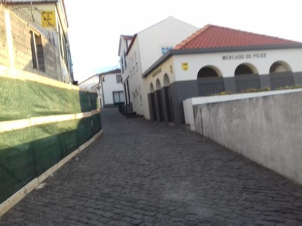
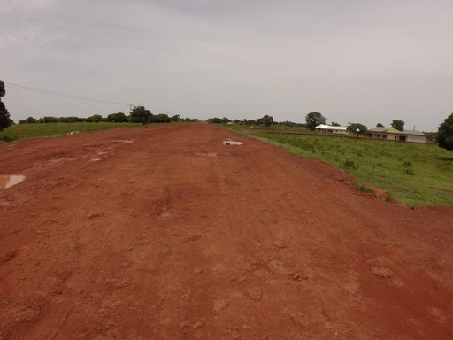

# GeoGuessr 現場線索與 LM LoRA

這輪想測兩件事。第一，能否教模型把照片裡的線索說準。第二，取得這些線索後，定位會不會更準。GeoGuessr 玩家常把地名、語言和道路設施一起用，因此我們同時測文字和道路觀察。 [Plonk It 初學者攻略](https://www.plonkit.net/beginners-guide)

本文的**原定位版**是已用 6,000 張街景做過座標微調的 Qwen3‑VL‑2B。**LM 續訓版**是從那組 LoRA 繼續訓練的版本。早一輪的 66 張測試中，原定位版直接猜對國家 33 張。同一個模型先抄文字、再把文字和整圖一起用來定位，猜對 30 張。其中一些圖沒有可核對的地名，模型卻抄出了地名。這是我們把「如實抄字」和「無字時留空」納入訓練的原因。 [續訓前的診斷](../clue_first/README.md)

## 方法

### 1. 怎麼挑出 104 張訓練圖

先從那 6,000 張裡按國家分散取樣，每個拍攝序列最多取一張，共整理了 3,140 張候選。用本機 OCR 找可能有文字的照片，再逐一看候選圖和放大區域，手動核對要放進訓練答案的字。道路標註則從候選圖另抽一批來看，記錄從照片本身能確認的屬性。

同一張照片可以出好幾道題。比方說，紅土路照片既能當「讀不到字就留空」的例子，也能問「路面有沒有鋪設」，還能問「照片在哪裡」。因此最後是 **104 張不同照片、258 道不同的訓練題**。

### 2. 每道題給模型什麼，答案是什麼

**市場招牌**是抄字題的實例。給模型整張照片，問「請抄出圖中可以核對的地名、路號或招牌文字」，人工標籤是 `{"text":["MERCADO DE PEIXE"]}`。這段葡語寫的是魚市場，知道它寫什麼可以成為定位線索。這道題的輸出只到抄錄為止。

照片來源為 OSV‑5M，拍攝者 zeylmans，CC BY‑SA 4.0。

下面這張**迦納紅土路**實際用了四次不同的問法。給模型的都是同一張整圖，訓練答案則隨任務而變。

照片來源為 OSV‑5M，拍攝者 mawutor，CC BY‑SA 4.0。

| 問法 | 這張照片的訓練答案 |
|---|---|
| 「把看得清的場景文字抄下來。」 | `{"text":[]}`，代表沒有可可靠抄錄的文字。 |
| 「描述路面、中央線和指定的路側設施。」 | `{"surface":"unpaved","centerline":"none","roadside":[]}`，也就是未鋪設、未見中央線、未見所列設施。 |
| 「這張照片在哪裡？」 | `{"country":"GH","latitude":8.838,"longitude":0.061}`，來自資料集的拍攝座標。 |
| 「這張照片在哪裡？可參考未鋪設、未見中央線、未見所列設施。」 | 仍是同一筆國家與座標。路況是額外輸入，定位才是這道題的答案。 |

道路題裡，`none` 是看得清楚道路、卻沒有中央線。`unclear` 是畫面太暗、被遮住，或無法分辨看到的是中央線還是路緣線。`roadside` 只記可見的護欄、電線桿、路側導標和交通牌。文字題把看不清楚的字和車載疊字排除，所以即使畫面邊緣有相機印上的日期，也可以用空陣列作答。

### 3. LoRA 怎麼訓練

每次給模型的是「照片＋一道問句」，用人工答案或原有 GPS 標籤做 **SFT**。模型在訓練時看到正確答案的前幾個 token，學著預測下一個，例如在 `{"text":` 之後接上正確的文字陣列。Loss 只算答案 token 的交叉熵，公里誤差留到評估時計算。ViT、projector 和 LM 基底權重固定，更新的是既有 LM attention 的 LoRA 權重。

| 訓練題型 | 照片數 | 每題呈現次數 |
|---|---:|---:|
| 有字，逐字抄錄 | 31 | 3 |
| 無可信文字，留空 | 69 | 2 |
| 描述可見道路 | 70 | 2 |
| 直接猜位置，延續原本的定位任務 | 54 | 2 |
| 讀取人工核對過的道路觀察，再猜位置 | 34 | 2 |

這些題目一起打散，共呈現 **547 次**。累積 8 筆梯度再更新一次，最後一組用剩下的 3 筆，合計 **69 次權重更新**。其中 **371 次是提取線索，176 次是定位**。訓練裡的「帶線索定位」題給的是**人工核對過的道路觀察**。評估才會測模型自己提取的文字和道路觀察能不能拿去定位。

### 4. 怎麼測線索有沒有幫到定位

66 張評估圖來自 66 位未見拍攝者，與訓練圖的影像 ID 和雜湊皆無重疊。選訓練方向前已在這批圖上做過診斷，所以這是同一批保留照片上的前後比較。先用整圖直接猜位置，再在同一張整圖旁附上模型一開始讀到的文字、道路觀察，或兩者。**第二步仍然保留整張照片。** 例如第 33 張的道路觀察是「鋪面道路、黃色中央線、未見所列路側設施」，這段文字會放到定位問句旁邊，請同一版模型再猜一次。

如果文字讀不到或格式無法解析，文字組沿用直接定位的答案。續訓版只有 7 張讀出了可解析的非空文字，所以「道路觀察與文字」那一列實際有 7 張帶入兩種線索，其餘沿用道路觀察組的答案。補跑舊版時，先拆掉包在答案外面的 Markdown 程式碼框等格式雜訊，再以相同欄位評分。

另外從這 66 張挑出幾組做人工核對。**5 張清楚招牌**看有沒有讀中指定詞，**21 張無可信文字**看會不會正確留空，**29 張道路圖**看鋪面和路側設施是否正確。29 張裡有 4 張的中央線不夠確定，所以中央線顏色和有無只評 25 張。定位的國家命中數與公里誤差另行計分。一張圖即使把所有道路線索描述對了，也仍可能猜錯國家。

模型版本、雜湊、訓練步數與逐張輸出都保存在 SSD。可用 `scripts/analyze_clue_training.py` 重算 `analysis.json` 和 `geo_metrics.csv`。

## 結果

完成 69 個 optimizer steps、547 次樣本呈現，學習率 6e‑5。只更新 3,211,264 個 LM LoRA 參數。前 10 步平均訓練 loss 0.693，後 10 步 0.382。訓練所見樣本及使用次數依任務記錄於 final ZIP 的 configuration.json。

### 能否讀出線索

| 人工核對項目 | 原定位版 | LM 續訓版 |
|---|---:|---:|
| 路面鋪設 | 28/29 | 28/29 |
| 可辨認的中央線顏色／無線 | 20/25 | 21/25 |
| 路側物件集合完全相符 | 7/29 | 27/29 |
| 無可信場景文字時正確留空 | 11/21 | 21/21 |
| 清楚文字讀中指定詞 | 1/5 | 1/5 |

舊版的道路 JSON 幾乎都包在 Markdown 框裡。表格及補跑的定位對照都先移除這層格式，再用相同條件核對內容。舊版 63/66 張可轉成有效道路觀察，新版是 66/66。道路物件上的差距主要來自少報圖上沒有看到的設施，例如額外報出電線桿由 13 次降到 1 次。鋪面及中央線辨識的變化較小。

文字格式原先 21/66 張有誤，只剝掉格式雜訊可救回 9 張。續訓後 66 張都可解析，其中 59 張留空，7 張有文字。Bouaké 從 BOUAKA 修正成 BOUAKÉ，但中文店招從能抄到「汽车钥匙」變成只報品牌。韓文招牌仍主要讀到門牌上的 6‑4。這組讀字改善主要是減少臆測及格式錯誤，清楚文字的辨識仍需改善。

### 能否用線索定位

| 66 張未見拍攝者照片 | 國家正確 | 200 km 內 | 25 km 內 | 有效定位數 | 有效定位的中位誤差 |
|---|---:|---:|---:|---:|---:|
| 原定位版，直接猜 | 33/66 | 14/66 | 1/66 | 66 | 600.3 km |
| 原定位版，加修格式後的文字 | 29/66 | 8/66 | 1/66 | 66 | 665.4 km |
| 原定位版，加修格式後的道路觀察 | 31/66 | 12/66 | 1/66 | 66 | 658.4 km |
| LM 續訓版，直接猜 | 30/66 | 10/66 | 2/66 | 65 | 591.9 km |
| LM 續訓版，加文字 | 29/66 | 9/66 | 2/66 | 65 | 591.9 km |
| LM 續訓版，加道路觀察 | 29/66 | 10/66 | 1/66 | 64 | 623.2 km |
| LM 續訓版，加道路觀察與文字 | 29/66 | 10/66 | 1/66 | 64 | 623.2 km |

配對只取雙方都輸出有效座標的照片。新舊版直接猜在共同 65 張上的中位誤差為 589.0 → 591.9 km。新模型加兩類線索，在共同 64 張為 586.9 → 623.2 km，25 張更近、32 張更遠、7 張變化不超過 1 km。原版和新版的觀察都是在同一批保留照片以相同問句擷取。兩版直接定位的比較沿用本研究在 T4 取得的原版預測與 L4 的新版預測，推論均為 FP16、4-bit NF4。

## 判斷

續訓版較少捏造路側設施，適合作為後續的線索擷取起點。這輪維持原 6,000 張版本作為定位基線。第 33 張芬蘭林道便很清楚，新版正確描述鋪面、黃中央線和未見路側物件，定位仍猜俄羅斯。黃線與樹林並存只提供範圍線索，接下來要驗證的是模型能否用多條互相獨立的線索排除國家候選。對可讀具名地點則可以另測地名查詢。這兩條路徑的輸出都可再用整張圖檢查。

[舊版診斷](../clue_first/README.md) · [芬蘭道路原圖](../clue_first/review/images/33.jpg) · [定位統計](geo_metrics.csv) · [最終 adapter 和訓練紀錄](clue-first-lm-final.zip)

Colab 完成全部測試後已終止，最終 ZIP 內只保留完成的 adapter 與設定、訓練紀錄。
