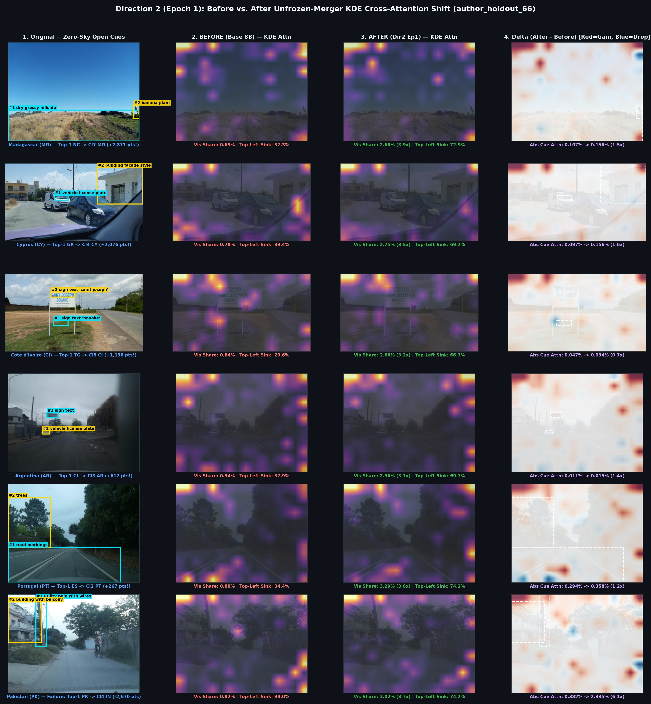
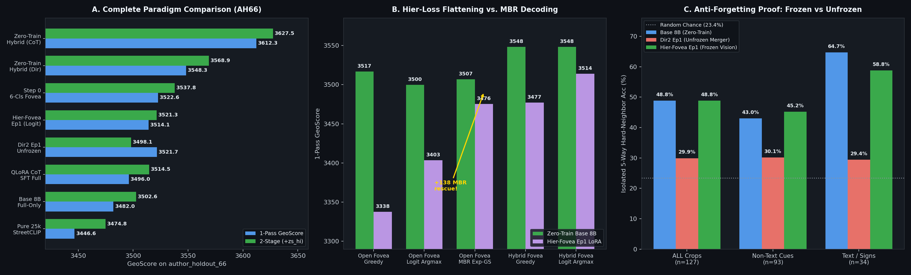
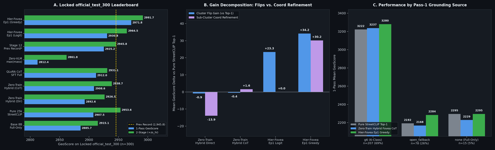
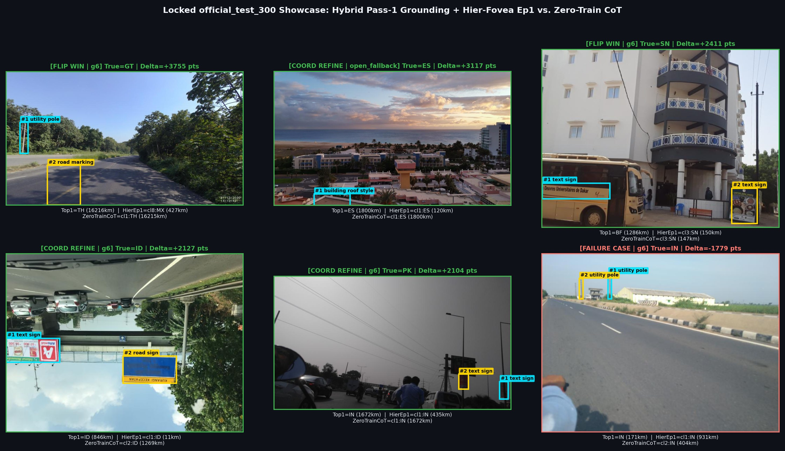

# Visual Fovea, Mechanistic Attention Diagnostics & Hierarchical Geographic Loss (`Stages 13–16`)

Holding the retrieval and vision-language backbone strictly fixed (**25k `StreetCLIP` `GeoProjector` + `Qwen/Qwen3-VL-8B-Instruct` 4-bit NF4**), we investigated why standard VLM fine-tuning plateaued on Top-8 spatial KDE reranking and developed a mechanistic visual-grounding + hierarchical geographic loss solution that raises the locked **`official_test_300`** record from **`2,945.8` → `2,991.7`** (`2,971.8` single-pass alone, **+401.6 GeoGuessr points** and **174–123** head-to-head over the 5M-image `osv5m/baseline`).

---

## 1. Stage 13 — Multi-Scale Top-8 CoT SFT, Offline DPO & Faithfulness Audit

Expanding the retrieval summary from Top-6 to **Multi-Scale Top-8 KDE clusters** (`scripts/prepare_multiscale_vlm_data.py`), we trained `Qwen3-VL-8B-Instruct` with LM QLoRA CoT SFT (`scripts/train_qwen8b_cot_sft_dpo.py`) and Rank-1-balanced Offline DPO (`scripts/train_balanced_dpo.py`) on strictly creator-disjoint `opt_train`:

- On `author_holdout_66`, QLoRA CoT SFT improved over full-image Base 8B (`3,482.0 → 3,496.0` single-pass; `3,502.6 → 3,514.5` two-stage), while Offline DPO regressed (`3,456.7 / 3,477.3`) due to Rank-1 shortcut collapse.
- On locked `official_test_300`, QLoRA CoT SFT reached `2,912.0` single-pass / `2,931.1` two-stage — still trailing the Stage 12 Top-6 record (`2,945.8`).
- **CoT Faithfulness Audit:** Flipping on readable signs/scripts gained `+6,078` total points (14 flips) and same-country sub-region refinements gained `+4,078` (42 flips), but these were cancelled by `-5,931` points lost across 54 flips where the generated CoT explicitly wrote `"no visible signs"`.

---

## 2. Stage 14 — Native Grounding, Cross-Attention Sink & Zero-Training Visual Fovea

To diagnose why the 8B VLM missed fine visual clues when conditioned on KDE tables, we probed `Qwen/Qwen3-VL-8B-Instruct` with zero weight updates (`scripts/run_step0_grounding_attention.py`, `scripts/run_step1_mil_and_sink.py`) on `author_holdout_66`:

1. **7.9× Cross-Attention Collapse & Top-Left Sky Sink:** Under a blind country prompt, final-token layer-averaged cross-attention to all visual tokens is `6.87%`. Once the Top-8 KDE candidate table enters context, visual attention collapses **7.9×** to **`0.87%`**, with **`23.5%`** concentrated on the single top-left sky corner patch `[0,0]` (`34.6%` in the top-left 15%×15% corner) and `< 0.6×` relative attention concentration inside every physical clue category (`utility pole` median `0.16×`, `bollard` median `0.18×`).
2. **Falsified Alternatives:**
   - **Frozen ViT Patch-MIL Saliency (`MIL-Fovea`):** Achieved `37.9%` Top-1 / `65.2%` Top-5 country classification purely by hijacking empty sky/cloud ViT register tokens (`+2.4` pts only when cropped).
   - **`Image-Last` Prompt Reordering:** Moving the image after the KDE table worsened visual collapse (`0.87% → 0.75%`) and dropped `author_holdout_66` by `-19.6` pts (`3,482.0 → 3,462.4`).
3. **Zero-Training Hybrid `Image-First` Visual Fovea:** Using `Qwen3-VL-8B` itself in Pass 1 to natively detect 6 high-precision infrastructure classes (`text sign`, `road sign`, `license plate`, `utility pole`, `bollard`, `road marking`) — with a zero-sky Open-Ended fallback (`scripts/run_dir2_harvest_crops.py`) when 6-class grounding returns `[]` — and injecting up to 2 high-res zoomed crops **before** the KDE table immediately set new records on `author_holdout_66`:
   - 6-Class Visual Fovea (CoT): `3,522.6` 1-pass / `3,537.8` 2-stage.
   - **Hybrid Visual Fovea (6-Class + Open Fallback):** **`3,548.3` / `3,568.9`** (Direct) and **`3,612.3` / `3,627.5`** (`69.7%` country acc., CoT).

---

## 3. Stage 15 — Unfrozen Visual Mergers Forensics (Why Unconstrained Merger Tuning Fails)

We next tested unfreezing `visual.merger` (`40.12M`) + `visual.deepstack_merger_list` (`120.38M`) = `160.50M` parameters (`lr=6e-5`) jointly with LM LoRA (`43.65M`, `lr=4e-5`) on 1,494 zero-sky isolated local-cue 5-way hard-neighbor MCQs + 642 Direct Open-Fovea tasks harvested from 862 creator-disjoint `opt_train` images (`scripts/train_dir2_unfrozen_merger.py`):

- While Direct Open-Fovea rose `+15.3` pts on `author_holdout_66` (`3,506.4 → 3,521.7`, median `289.9 km`), isolated local-cue MCQ collapsed (`48.82% → 29.92%`; text/signs `64.71% → 29.41%`) and CoT Open-Fovea regressed `-180.1` pts (`3,518.0 → 3,337.9`).
- **Two Mechanistic Failure Modes Identified:**
  1. **Distractor-Prior Confounder:** Filtering `len(distractors) == 4` removed high-confidence positives from major countries (`US=0%`, `IN=3.9%`, `DE=10.0%`) while keeping them as frequent negative distractors for smaller neighbors (`CU=46.2%`, `LK=45.5%`). On low-prior countries (`P_train < 16%`), accuracy collapsed `61.8% → 17.6%`, whereas on high-prior countries (`≥ 22%`) accuracy actually rose `40.5% → 47.6%`.
  2. **2.57× Pixel `[0,0]` Attention-Sink Amplification:** Although total KDE visual attention rose `3.39×` (`0.87% → 2.94%`), single-pixel `[0,0]` sink share surged from **`23.5% → 60.3%`** (`71.6%` in the top-left 15% corner), showing unconstrained merger gradients compressed global summary features into register token `[0,0]` at the expense of local OCR alignment.

---

## 4. Stage 16 — Frozen-Vision Visual Fovea + Hierarchical Multi-Scale Geographic Loss (`Hier-Fovea LoRA`)

Synthesizing all findings from Stages 13–15, we designed **`Hier-Fovea LoRA`** (`scripts/train_hier_fovea_lora.py`, `scripts/prepare_hier_fovea_bundle.py`):

1. **Frozen Vision & Mergers (`0` visual trainable params):** Completely preserves Qwen3-VL's native OCR and prevents `[0,0]` sink amplification. On the `author_holdout_66` anti-forgetting isolated MCQ benchmark, `Hier-Fovea Ep1` retained **`48.82%`** overall (`0.0%` forgetting vs. `29.92%` for unfrozen mergers) and improved non-text physical cue accuracy (`43.01% → 45.16%`).
2. **Pure Visual Fovea Training (No MCQ Shortcut):** Trained exclusively on 820 creator-disjoint `opt_train` Visual Fovea examples across 178 countries (`keep_top1=303`, `cross_country_flip=271`, `same_country_region_flip=129`, `near_neighbor_<=1500km=117`), strictly verified for zero ID overlap with `official_test_300`.
3. **Differentiable Hierarchical Multi-Scale Geographic Loss:** At the `selected_cluster` (`1..K`) decision token, the hard one-hot SFT CE label is masked (`-100`) and replaced with a 4-scale geographic loss over the candidate cluster logits $p_\theta(k)$ using exact Haversine distances $d_k$:
   $$\mathcal{L}_{\text{hier}} = 0.25\,\text{KL}(q_{2500} \,\|\, p_\theta) + 0.40\,\text{KL}(q_{\text{country}, 750} \,\|\, p_\theta) + 0.25\,\text{KL}(q_{200} \,\|\, p_\theta) + 1.50\Big(\max_j e^{-d_j / 1492.7} - \sum_{k=1}^K p_\theta(k)\,e^{-d_k / 1492.7}\Big)$$
   combined with `0.35 × L_sft_rest` supervising true GPS coordinates `(latitude, longitude)`, country ISO, and confidence when the true country is in Top-8 (pure $\mathcal{L}_{\text{hier}}$ otherwise).

---

## 5. Locked Zero-Touch `official_test_300` Paired Showdown (`n = 300`, 147 Countries)

In a single locked Colab L4 evaluation (`scripts/run_locked_test300_fovea_showdown.py`), Pass-1 Hybrid Native Grounding covered **`285/300 (95.0%)`** of unseen test images (`g6=207`, `open_fallback=78`, `none=15`). We then evaluated Zero-Training Hybrid Visual Fovea (`CoT` & `Direct/Logit/MBR`) and trained **`Hier-Fovea Ep1`** head-to-head on the **exact same Pass-1 crops**:

| Method (`official_test_300`, fixed 25k `StreetCLIP` + `Qwen3-VL-8B`) | 1-Pass Country | 1-Pass ≤ 200 km | 1-Pass ≤ 750 km | 1-Pass Med km | **1-Pass GeoScore** | **2-Stage (`+zs_hi`)** | 2-Stage Med km |
|---|---:|---:|---:|---:|---:|---:|---:|
| Zero-VLM `argmax(cluster.mass)` | 43.7% (131) | 61 | — | 619.3 km | 2,812.4 | 2,861.8 | 588.8 km |
| Base 8B Full-Only (Top-8 CoT) | 48.3% (145) | 70 | — | 609.3 km | 2,885.7 | 2,915.1 | 570.6 km |
| Zero-Train Hybrid Visual Fovea (Direct Greedy) | 49.3% (148) | 73 | — | 582.9 km | 2,892.6 | 2,926.5 | 561.7 km |
| Pure 25k `StreetCLIP` Top-1 (`cls[0]`) | 48.0% (144) | 73 | 174 (58.0%) | 570.3 km | 2,907.5 | 2,953.6 | 552.5 km |
| Zero-Train Hybrid Visual Fovea (CoT) | **49.7% (149)** | 72 | 171 (57.0%) | 572.0 km | 2,908.6 | 2,938.7 | 560.5 km |
| QLoRA CoT SFT Full-Only (Stage 13) | 48.0% (144) | 71 | — | 594.6 km | 2,912.0 | 2,931.1 | 561.2 km |
| Stage 12 Previous Record (Top-6 Two-Stage) | 48.0% (144) | 76 | 174 (58.0%) | 556.7 km | 2,925.2 | 2,945.8 | 556.7 km |
| `Hier-Fovea Ep1` LoRA (Logit Argmax, Centroids) | 48.7% (146) | 72 | — | 561.8 km | 2,930.8 | 2,964.5 | 543.9 km |
| **`Hier-Fovea Ep1` LoRA (Direct Greedy, Ours)** | **48.7% (146)** | **75 (25.0%)** | **179 (59.7%)** | **534.6 km** | **2,971.8** | **2,991.7** | **514.5 km** |

### Statistical Significance & Forensic Gain Decomposition

- **Paired Bootstrap (`10,000` resamples, two-sided $p$):**
  - `Hier-Fovea Ep1` vs. Pure 25k `StreetCLIP` Top-1: **`+64.3`** (`[+16.5, +117.6]`, **`p = 0.0058`**)
  - `Hier-Fovea Ep1` vs. Base 8B Full-Only Top-8: **`+86.2`** (`[+15.8, +158.2]`, **`p = 0.0166`**; two-stage **`+76.5, p = 0.0212`**)
  - `Hier-Fovea Ep1` vs. Zero-Train Hybrid Fovea Direct (identical crops & prompt): **`+79.2`** (`[+10.4, +150.8]`, **`p = 0.0256`**)
  - `Hier-Fovea Ep1` (2-Stage **`2,991.7`**) vs. 5M-image `osv5m/baseline` (`2,590.1`): **+401.6 GeoScore**, **−289.9 km median error**, **`174 wins – 123 losses – 3 ties`** (single-pass alone: `171–127–2`).
- **Exact `+64.3` Decomposition (vs. StreetCLIP Top-1):**
  1. **Disciplined Cluster Flipping (`+34.2` pts):** Zero-training models over-flipped on hard unseen scenes (`61–73` flips, `42.5%` win rate → `-0.4 / -0.9` net). Trained with hierarchical distance penalties, `Hier-Fovea Ep1` flipped only **`31/300`** times at a **`58.1%`** win rate (`18` wins vs. `13` losses), including Guatemala (`Thailand 16,216 km → Mexico 427 km, +3,755`), Senegal (`Burkina Faso 1,286 km → Dakar 150 km, +2,411`), Bonaire (`DO 870 km → Curaçao 94 km, +1,904`), and South Korea (`Taiwan 1,544 km → Korea 491 km, +1,822`).
  2. **Sub-Cluster Coordinate Refinement (`+30.2` pts):** Zero-training models copied cluster centroids verbatim (`>10 km` shift on only `2/300` images). Supervised on true GPS coordinates with frozen vision/OCR intact, `Hier-Fovea Ep1` actively shifted coordinates off cluster centroids on `69/300` images (`48` wins vs. `40` losses), e.g., moving mainland Spain (`1,800 km`) to the Canary Islands (`120 km, +3,117`), Batam (`846 km`) to Jakarta (`11 km, +2,127`) even on an upside-down photo, and Malaysia (`256 km → 1 km, +784`).
  3. **Consistent Wins Across Every Pass-1 Stratum:** `g6` (`n=207`: `3,221.5 → 3,279.9`), `open_fallback` (`n=78`: `2,191.9 → 2,284.4`), and `none` (`n=15`: `2,295.0 → 2,294.9`, zero degradation).

---

## 6. Reproduction & Artifacts

- **Summary JSON:** [`test300_final_analysis_summary.json`](test300_final_analysis_summary.json)
- **Scripts:**
  - Stage 13: [`multiscale_vlm_utils.py`](../../scripts/multiscale_vlm_utils.py), [`prepare_multiscale_vlm_data.py`](../../scripts/prepare_multiscale_vlm_data.py), [`train_qwen8b_cot_sft_dpo.py`](../../scripts/train_qwen8b_cot_sft_dpo.py), [`train_balanced_dpo.py`](../../scripts/train_balanced_dpo.py), [`run_qwen8b_multiscale_test300.py`](../../scripts/run_qwen8b_multiscale_test300.py)
  - Stage 14: [`run_step0_grounding_attention.py`](../../scripts/run_step0_grounding_attention.py), [`run_step1_mil_and_sink.py`](../../scripts/run_step1_mil_and_sink.py)
  - Stage 15: [`run_dir2_harvest_crops.py`](../../scripts/run_dir2_harvest_crops.py), [`train_dir2_unfrozen_merger.py`](../../scripts/train_dir2_unfrozen_merger.py)
  - Stage 16: [`prepare_hier_fovea_bundle.py`](../../scripts/prepare_hier_fovea_bundle.py), [`train_hier_fovea_lora.py`](../../scripts/train_hier_fovea_lora.py), [`prepare_test300_fovea_bundle.py`](../../scripts/prepare_test300_fovea_bundle.py), [`run_locked_test300_fovea_showdown.py`](../../scripts/run_locked_test300_fovea_showdown.py)
